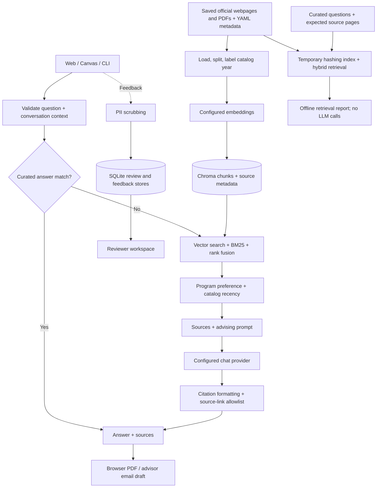

# SJSU iSchool Advising Chatbot

## Team

- Christopher Velez ([CrashPr0](https://github.com/CrashPr0))
- Marios Tawdros ([mariostawdros](https://github.com/mariostawdros))
- Joshua Rieta ([cho-sua](https://github.com/cho-sua))

## Project Description

An advising assistant for San José State University's BS in Information Science and Data Analytics (ISDA) and Master of Library and Information Science (MLIS) programs. Students can ask about published requirements, registration, and advising resources, follow source links, and prepare an advisor email draft. All of this is to help students get information that they need faster, and to alleviate the workload of ISDA and MLIS advisors.

[Hosted demo](https://ischooladvisingchatbot-dx4ynl.azurewebsites.net/) · [Offline evaluation report](docs/eval/latest.md) · [Canvas integration](docs/canvas-embed.md)

Start with the [measured baseline](#measured-retrieval-baseline), [local setup](#run-locally), or [test commands](#test-and-review).

## Prototype Scope

Currently we have a working website hosted on Azure that runs based off the current GitHub repository (repo), and can take in inputs from both keyboard and microphone. The chatbot comes from preset questons to be asked, however the chatbot still thinks for these questions and answers may vary, especially with the three different settings on where to advise from (currently, for ISDA, MLIS, or neither/both if one is confused). Other features include, the ability to copy the chatlog as a PDF, report any problems found while using the chatbot, option to send an email to an advisor for the questions asked in the chatbot, and links to other helpful sources.

#### Technical Features

- **Hybrid RAG:** vector search and local BM25 fused with reciprocal rank fusion; course-code normalization, program-aware ranking, and lexical fallback when query embeddings fail.
- **Citations and link verification:** source metadata supplies document titles and URLs; an allowlist removes unsupported answer links and records gaps for review. Verification checks source membership, not live HTTP availability.
- **Catalog-year detection:** extracts catalog identity, labels year-specific context, prefers current snapshots for matching courses/programs, and flags potentially stale catalog data.
- **Reviewer tools:** blinded A/B answer scoring, editable reviews, completion-gated aggregates and CSV export, student issue reports, and anonymized popular-question counts.
- **PII scrubbing:** redacts supported student-ID, email, US phone, and street-address patterns before free-text feedback, reviewer comments, question logs, and stripped-link records are stored.
- **PDF export:** creates a conversation PDF in the browser with vendored jsPDF and a print fallback.
- **Advisor handoff:** prepares an editable email draft for the student to send to an advisor.
- **Canvas embedding:** supports SJSU Canvas iframes and a compact `?embed=1` layout.
- **Web and CLI access:** responsive web chat, curated question autocomplete, optional browser voice input/output, and a CLI.

The assistant provides published information and directs personal decisions to advisors. It cannot access student records, clear prerequisites, or make enrollment decisions. Pattern-based PII scrubbing does not guarantee removal of all personal information.

## System Architecture



The request path starts in [app.py](app.py). [RAGAdvisingChatbot](src/rag_chatbot.py) coordinates curated answers, retrieval, and generation; [hybrid_retrieval.py](src/hybrid_retrieval.py) implements ranking; [DocumentProcessor](src/document_processor.py) loads and indexes source snapshots. Chat providers and reviewer storage have separate modules under `src/`.

Documents are ingested before chat requests. The web API checks an index receipt before answering, so an absent or mismatched index cannot silently serve a new release. The offline harness uses the same loader, splitter, hashing embedder, and hybrid ranking function in an isolated temporary index. It evaluates retrieval directly, bypassing curated-answer lookup and answer generation.

### Measured retrieval baseline

The [generated report](docs/eval/latest.md) records the full method, input hashes, per-question expected/retrieved pages, exclusions, and timing evidence.

| Metric | Recorded result at k = 4 chunks |
| --- | --- |
| Curated questions retrieved / relevance-scored | 21 / 16 |
| Retrieval hit rate@4 | **75.00% (12/16)** |
| Macro source recall@4 | **62.50%** |
| Offline citation-link validity | **100.00% (84/84 returned chunks)** |
| Retrieval latency mean / p50 / p95 | **9.13 / 3.86 / 6.37 ms** |
| Saved documents / indexed chunks | 79 / 565 |

The table comes from the command below; the generated report records the execution environment and input hashes. These measurements use deterministic 2048-dimensional hashing embeddings plus BM25, with no chat model or network link probes. Hit rate requires at least one expected page; recall measures the fraction of expected pages found per question, then averages across questions. Five boundary/distress cases are excluded from relevance scoring and remain listed in the report. Their latency and source links are still measured. Link validity checks URL structure and corpus membership; it does not measure answer correctness or live reachability. Timing includes the first cold retrieval, excludes index construction, and varies by machine. The observed misses remain visible as a baseline for future retrieval work.

Reproduce from the repository root after installing dependencies:

```bash
python -m scripts.eval_report --k 4
```

The default writes `docs/eval/latest.md`. Use `--help` for custom inputs, retrieval depth, and output paths; reports preserve custom input paths in their reproduction command. Expected pages and explicit exclusions live in [evals/retrieval_expectations.json](evals/retrieval_expectations.json), keyed to the unchanged [curated questions](evals/advising_questions.json). The harness forces hashing embeddings for its own run even when hosted embeddings are configured, disables Chroma telemetry, and deletes its temporary collection. It does not open the app's saved index. No credentials are needed for evaluation.

### Data and implementation

| Area | Location / technology |
| --- | --- |
| Web server and endpoints | [app.py](app.py), Flask, Gunicorn |
| Retrieval and answer pipeline | [src/](src/), LangChain, Chroma, BM25, reciprocal rank fusion |
| Source snapshots | [data/advising_docs/](data/advising_docs/README.md), text/PDF + YAML metadata |
| Ingestion | [src/scrape_ischool.py](src/scrape_ischool.py), bounded offline crawl; Beautiful Soup, trafilatura, pypdf |
| Browser interface | [templates/](templates/), [static/](static/), HTML/CSS/JavaScript, jsPDF, Web Speech API |
| Review and feedback | SQLite, reviewer access controls, PII scrubber |
| Evaluation | [scripts/eval_report.py](scripts/eval_report.py), [evals/](evals/), pytest |
| Hosting and operations | Azure App Service; [deployment runbook](AZURE_DEPLOYMENT.md), [operations log](docs/ops-log.md) |

Add source text or PDFs under `data/advising_docs/txt/` or `pdfs/`, with matching YAML under `meta/`. Metadata carries stable IDs, titles, source URLs, topics, and program tags. The crawler saves snapshots before indexing and does not run at query time. Review source changes and rebuild the index before using them in chat. Relevant university-wide sources remain available alongside program-specific ISDA and MLIS pages.

The committed current catalog is identified by `CURRENT_CATALOG_CATOID` (23) and `CURRENT_CATALOG_YEAR` (2026-2027). Reproduce these catalog values with `cat data/catalog_identity.json`. The catalog update tool maintains these README values alongside the catalog identity file; older snapshots remain available for earlier catalog rights.

See [Canvas embedding](docs/canvas-embed.md) and [curated suggestion ranking](docs/dynamic-suggestions.md) for integration details. Deployment settings, durable paths, health probes, and rollback procedures are documented in the runbook.

## Prequisites

Since it can be run from our Azue site, a working browser and internet is the minimum required. However for running it on your own system, you must have the following:
- Terminal Admin Access (for installing Git, Python, and running commands)
- Git (For downloading the repo)
- Python (For running the program)
- API Key (For the chatbot to run. preferably from OpenAI as that is what is currently used)
- Browser
- Internet

## Installation

Due to how it is currently set up, there is no official way to install it since it requires API keys and a host site. An easy way to run it is to run through the provided Azure link. However, to download and run locally, clone the repo and follow the steps below for running it.

## Running the Prototype

### Run Locally
CI uses **Python 3.11**; this local evaluation and test run used **Python 3.13.5**. Check your interpreter with `python --version`. Run commands from the repository root and keep the virtual environment active for the commands below.

```bash
python3 -m venv .venv
source .venv/bin/activate
# Windows PowerShell activation: .venv\Scripts\Activate.ps1
python -m pip install -r requirements.txt
```

`requirements.txt` applies the transitive lock in `constraints.txt`. To try the project without credentials, run the [offline evaluation](#measured-retrieval-baseline) or [test suite](#test-and-review) now. Neither requires `.env`, a running server, or a configured chat model.

For interactive chat:

```bash
cp .env.example .env
```

Edit the local `.env` to configure one supported chat provider. For example, set `DEFAULT_LLM_PROVIDER=openai` and your `OPENAI_API_KEY`. Keep `EMBEDDING_PROVIDER=hashing` for quota-free indexing and retrieval; generated chat answers still call the configured provider. Set `DOCS_LOAD_TOKEN` to a private local admin token for the web rebuild endpoint. Keep `.env` and credentials out of git.

```bash
python app.py
```

Open <http://localhost:5000>. In a second terminal, request the initial index build with the same local admin token:

```bash
curl --request POST http://localhost:5000/api/load-docs \
  --header 'X-Admin-Token: <your-local-DOCS_LOAD_TOKEN>'
curl http://localhost:5000/readyz
```

Replace the token placeholder locally. The build is asynchronous: repeat the readiness request until it returns HTTP 200 before sending a chat message. `/healthz` checks server liveness; `/readyz` checks the release/embedding index receipt. A CLI-only session can build the document index directly:

```bash
python -m src.build_index --docs ./data/advising_docs
python -m src.main
```

The CLI build creates the index but does not write the web readiness receipt; use the web rebuild endpoint for the web app. Local defaults store the index under `data/chroma` and reviewer data under `evals/`, both gitignored.

Provider selection supports OpenAI, Azure OpenAI, Anthropic, Hugging Face, and OpenAI-compatible endpoints. For optional local Sentence Transformers embeddings, install `requirements-local.txt` and set `EMBEDDING_PROVIDER=local`; the model may need an initial download. Rebuild the app index whenever the embedding identity or document corpus changes. The offline report always uses hashing embeddings for a consistent baseline.

### Running Online

An online version of the chatbot exists in the link below. Here it is hosted on Azure and updates automatically when the repo is updated.

Online Chatbot: https://ischooladvisingchatbot-dx4ynl.azurewebsites.net/
## Testing

```bash
python -m pytest tests/ -q
python -m black --check scripts/eval_report.py tests/test_eval_report.py
python -m flake8 scripts/eval_report.py tests/test_eval_report.py --max-line-length=88
```

Recorded local result from the commands above: **573 passed**, with a dependency deprecation warning; both lint checks passed. Black/Flake8 cover the offline harness files listed in those commands. The [pull request workflow](.github/workflows/pr-tests.yml) runs the full suite and a dependency audit; it does not currently enforce repository-wide lint.

Tests cover retrieval, catalog metadata, source-link handling, API behavior, reviewer storage/access, PII scrubbing, browser features, and ingestion. Harness tests verify metric denominators, duplicate-page handling, missing/invalid links, complete labels, protected curated question text, custom-input reproduction commands, and a real temporary-index run with network connections blocked and hosted embedding settings present.

### Review Tests
For human answer review, visit `/evaluation`. Localhost can use the reviewer workspace without a shared secret; public deployments require configured reviewer access. [src/model_benchmark.py](src/model_benchmark.py) provides a separate provider-backed A/B benchmark and `--help` documents its options. That benchmark can incur model charges; it is separate from the offline retrieval report. In summary, these tests are preset questions using two different chatbots (in this test, GPT-4o-Mini and GPT-5.6-Luna), which have a spread of eight questions to see if responses are adequate. Here, they can be scored and compared to see which one has given a preferred answer.

### Tests Online
Tests could be accessed online too similar to the chatbot site (both hosted on Azure). However, you must have a whitelisted email in order to have access.
Test Link: https://ischooladvisingchatbot-dx4ynl.azurewebsites.net/evaluation

## Demo
Video: https://drive.google.com/file/d/1-gSFG6awRieQEQF1olQu8MsKjWODNFDG/view?usp=sharing
Online Chatbot: https://ischooladvisingchatbot-dx4ynl.azurewebsites.net/
Evaluation/Tests: https://ischooladvisingchatbot-dx4ynl.azurewebsites.net/evaluation

## Technical Stack
Built with Python, Flask, LangChain, and Chroma, the project combines curated answers with retrieval-augmented generation (RAG). The engineering focus is inspectable answers: hybrid retrieval over saved official sources, catalog-year context, reviewable feedback, and an offline retrieval benchmark that runs without credentials or paid model calls. Along with these, it is ran online using Azure, handling APIs, and to run this we are using OpenAi GPT-5.6-Luna to handle questions.


## What's Next
For the upcoming Project Expo, we will be continuing testing in order to find bugs, link if the chatbot makes up any information or links. We will also improve the using experience to make it easy and comfortable to use for anyone. Another thing we will take in mind is how it responds back in certain situations, like if someone asks it how to take their own life, we want it to respond in a way that it will help them find the help they need, but not in a way that startles them. Besides that, we will continue to optimize the project overall.

## Hosting reference

The existing Azure startup command is `gunicorn --config gunicorn.conf.py app:app`. Leave `VECTOR_STORE_PATH` unset to use the platform-aware defaults: `/home/data/chroma` for the Azure index and `/home/data/evaluation/reviews.sqlite3` for review data. `/tmp/chroma` is not durable across restarts. `/healthz` remains the liveness probe; `/readyz` validates the index receipt. HTTPS Only is enabled on the hosted app. See the [deployment runbook](AZURE_DEPLOYMENT.md) and [operations log](docs/ops-log.md) for the existing configuration.

## Project References

- [Advising chatbot rubric](https://docs.google.com/spreadsheets/d/1kXhvObOL_13er0D4eyMBNfHel7tIFF4seUtL0yQtMk8/edit?usp=sharing)
- [Smoke test question set](https://docs.google.com/document/d/1KON-OufGsHjJpwY_hQp5m_doXAMw-rn98g4Oz9YvCQY/edit?usp=sharing)
- [Figma design](https://www.figma.com/design/J5cIoGXTAs7K07Q5X988Z6/iSchool-Chatbot-Site-RD?node-id=0-1&p=f&t=z4ZYAu1mDT8v6J8y-0)
- [License](LICENSE)
