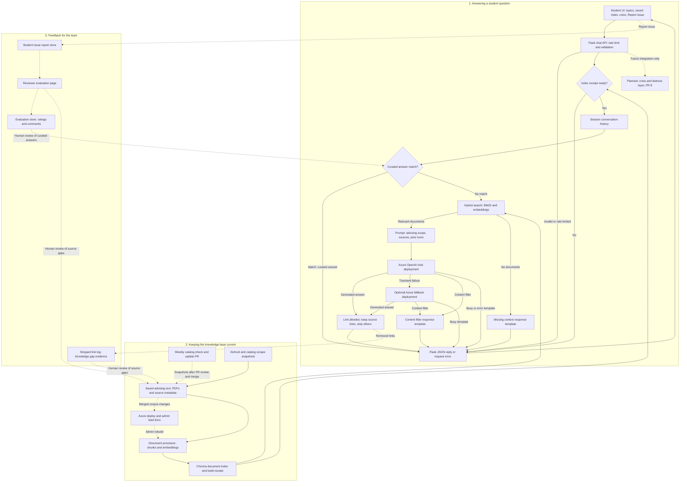

# How the advising chatbot works

The chatbot helps students with SJSU's BS in Information Science and Data Analytics advising questions. It first looks for a curated answer; otherwise, it searches saved advising documents and asks a language model to answer from those sources. The diagram shows the code on `main`, with the separate, unmerged crisis/distress safety layer from PR #8 marked **planned**.

Solid arrows show the question and document pipelines. Dotted arrows show feedback and maintenance; arrows labeled **human review** require people to decide and edit. The dashed box is planned work, not a live step. The three groups are: answering a question, keeping the knowledge base current, and feedback for the team. A rendered PNG is in `docs/architecture.png`.

- **Student UI** — `templates/index.html` and `static/script.js` provide topic chips, conversation tabs saved in browser `localStorage`, and a Report issue button on answers. `sendMessage()` sends text to Flask; browser speech recognition and speech synthesis provide voice input/output when enabled and supported, using settings from `app.py:voice_config()`.
- **Chat API** — `app.py:chat()` handles `POST /api/chat`, applying `_FixedWindowRateLimiter` and checking the JSON message, length, and optional conversation ID. Invalid or excessive requests return an error before answering.
- **Index readiness** — `app.py:_advising_index_refusal()` checks the build receipt through `_index_readiness_report()` before loading the chatbot. A missing, stale, or mismatched receipt returns HTTP 503; the receipt must match the release and configured embedder.
- **Session history** — `app.py:_SessionHistoryStore` keeps bounded, temporary history in server memory, isolated by the browser session and optional conversation ID. `chat()` passes a snapshot of earlier turns to the chatbot and records the new answer; this is separate from browser-saved conversations.
- **Curated answers** — `src/knowledge_base.py:KnowledgeBase.find_answer()` matches common questions to repository-owned answers. `src/rag_chatbot.py:RAGAdvisingChatbot._chat_with_metrics()` returns a match directly, bypassing document retrieval and model generation.
- **Document search** — `src/document_processor.py:DocumentProcessor.retrieve_relevant_docs()` calls `src/hybrid_retrieval.py:hybrid_retrieve()` to combine BM25 word matching with embedding/vector rankings. `HYBRID_RETRIEVAL=true` enables this and is the default when unset; `false` selects vector-only search, while a query embedding failure in hybrid mode can fall back to BM25.
- **Prompt and live scope instructions** — `src/rag_chatbot.py:RAGAdvisingChatbot.SYSTEM_PROMPT`, `_build_context()`, and `_prior_turns_context()` combine advising-only source instructions, retrieved text, catalog/graduation guidance, the question, and bounded prior turns. These instructions prohibit invented facts and personal student records, and treat earlier conversation as context rather than new instructions; they are prompt instructions, not a dedicated scope classifier.
- **Chat model** — `src/llm_providers.py:LLMFactory._create_azure_openai()` creates the Azure OpenAI chat client when that provider is selected, using `AZURE_OPENAI_DEPLOYMENT`. `src/config.py` sets the Azure benchmark's left deployment default to `gpt-4o-mini` (used by `src/model_benchmark.py:parse_args()`), but does not hardcode the live Azure chat deployment; the general provider default is `openai`.
- **Optional model fallback** — `src/rag_chatbot.py:RAGAdvisingChatbot._generate()` tries `AZURE_OPENAI_FALLBACK_DEPLOYMENT` after transient model failures such as rate limits, timeouts, or server errors. `_generate_fallback()` returns a busy template if the fallback fails; content-filter failures do not trigger this fallback.
- **Content-filter handling** — `src/rag_chatbot.py:_is_content_filter()` recognizes provider content-filter failures, and `RAGAdvisingChatbot._filtered_text()` supplies a fixed English or Chinese response. This handling and curated answers are live; they do not constitute the planned crisis/distress layer.
- **Links and citations** — `src/rag_chatbot.py:_apply_link_allowlist()` checks model-generated links against this turn's document text, source URLs, and vetted repository templates, stripping other targets while retaining useful text. Source headings and catalog years enter the prompt through `src/catalog_recency.py:document_heading()`; citations are part of answer text, not a separate citation-verification service, and curated/template replies bypass the model-text filter.
- **Missing context** — `src/rag_chatbot.py:RAGAdvisingChatbot._missing_context_response()` directs the student to advising when no documents are found, without calling the model. The same template replaces a generated answer if stripping links leaves no substantive text.
- **Reply to the student** — `app.py:chat()` returns JSON containing the answer and source/confidence metadata, or an API error. `static/script.js:deliverBotReply()` displays successful answers, saves them to the browser conversation, and makes them reportable.
- **Planned safety layer** — The dedicated crisis/distress layer is in separate, unmerged PR #8 and is not implemented in this checkout. `app.py:chat()` already has compatibility hooks for a future `safety_tier` result, but those hooks do not detect distress or produce crisis replies today.
- **Scrape snapshots** — `src/scrape_ischool.py:SiteCrawler.crawl()` and `sync_pages()` fetch allowed seed pages and save text, source metadata, and a manifest. This is an operator-run source-refresh pipeline, not a web search performed for each student question.
- **Weekly catalog check** — `.github/workflows/check-sjsu-catalog.yml` runs `scripts/check_sjsu_catalog.py` weekly or manually, calling `src/catalog_update.py:check_for_newer_catalog()`. When a newer current catalog is successfully read, it refreshes ISDA snapshots/settings, runs tests, and opens a PR for human review rather than merging automatically.
- **Saved sources** — `data/advising_docs/` holds the committed text/PDF corpus, metadata, and scrape controls. `src/document_processor.py:DocumentProcessor.load_documents()` reads the advising evidence, excluding crawler controls and non-evidence files; `DOCS_PATH` can override its location.
- **Deployment and rebuild** — `.github/workflows/deploy-azure.yml` deploys applicable changes on `main` to Azure App Service and runs `scripts/verify_deployed_index.py`. That script calls the protected `POST /api/load-docs?async=true`, polls progress, and verifies the deployed index; `app.py:_run_docs_index_job()` builds it and writes the receipt.
- **Chunks and embeddings** — `src/document_processor.py:DocumentProcessor.process_and_index()` splits documents into searchable chunks and builds the index using `_create_embeddings()`. `EMBEDDING_PROVIDER` supports default offline `hashing`, `local` MiniLM, `openai`, `azure_openai` using `AZURE_OPENAI_EMBEDDING_DEPLOYMENT`, or `auto` selecting configured Azure, then OpenAI, then local embeddings (`src/config.py:Config.resolved_embedding()`).
- **Chroma index** — `src/document_processor.py:DocumentProcessor.create_vector_store()` publishes a newly built Chroma collection after successful indexing. `VECTOR_STORE_PATH` overrides storage; `src/durable_storage.py:resolve_vector_store_path()` defaults to `/home/data/chroma` on Azure and `./data/chroma` locally, with `index_build.json` recording build readiness.
- **Issue reports** — `app.py:create_issue_report()` validates and saves reports through `src/issue_reports.py:build_issue_report()` and `IssueReportStore.save()`. Each report includes the flagged question/answer, reason, and optional comment; additional conversation, model, and link details are retained only when the student opts in.
- **Reviewer page** — `app.py:evaluation_dashboard()` serves `templates/evaluation.html` with `static/evaluation.js` at `/evaluation`. Signed-in reviewers can view student reports through `list_issue_reports()` and compare benchmark answers in the evaluation workspace.
- **Reviewer ratings** — `src/evaluation_store.py:EvaluationStore.save_review()` saves accuracy, tone, succinctness, edge-case ratings, and comments on benchmark candidates; `summary()` and `export_csv()` support analysis. Ratings and student reports use separate tables in the reviews SQLite database, defaulting to `/home/data/evaluation/reviews.sqlite3` on Azure.
- **Stripped-link evidence** — `src/stripped_link_log.py:record_stripped_links()` records the current question, removed URLs, and whether the answer was edited or replaced, in a separate SQLite log. `StrippedLinkLog.records()` lets maintainers inspect this evidence for missing sources; there is no automatic knowledge-gap repair service or reviewer-page integration for this log.

## Feedback loops

- **Student reports to faculty review:** Report issue submissions appear on the authenticated evaluation page. Reviewers can use reported inaccuracies or outdated answers to guide manual edits to curated answers or document sources; reports do not automatically change answers.
- **Removed links to source improvements:** Maintainers can inspect the stripped-link log for repeated questions whose generated links were absent from the allowed evidence. A removed link is a lead for investigation, not proof that the linked page is valid or should be added.
- **Reviewer ratings to quality decisions:** Stored benchmark ratings, comments, summaries, and CSV exports help faculty compare answer quality and decide which content or configuration needs attention. The store does not train the model or automatically update the knowledge base.
- **Source updates to the next index:** The weekly catalog workflow proposes newer-catalog changes in a PR; the scrape tool supports operator-driven refreshes of iSchool and other allowed sources. After reviewed corpus changes reach `main`, the deploy workflow rebuilds Chroma through admin load-docs and verifies the release receipt before student chat can use it; curated-answer edits live separately in `src/knowledge_base.py`.
